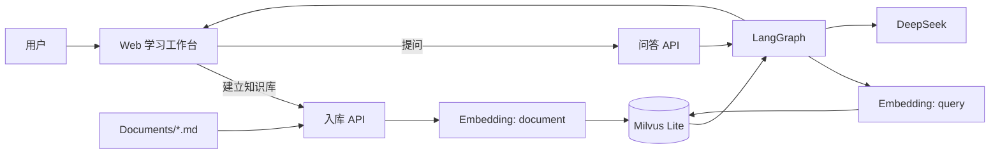
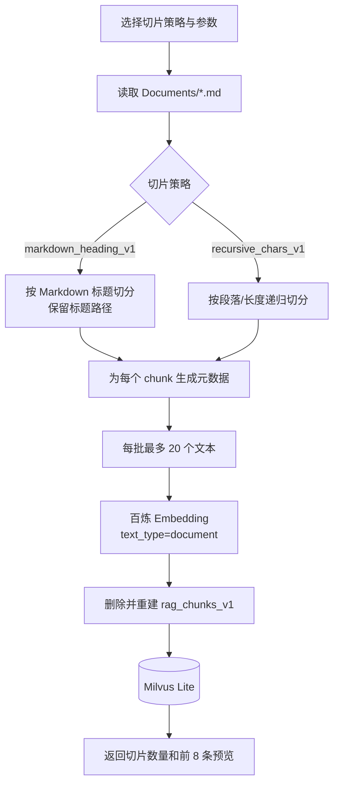
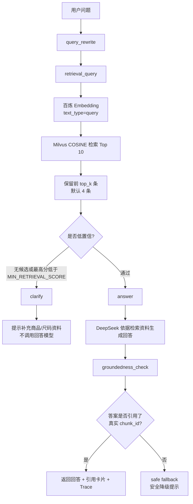
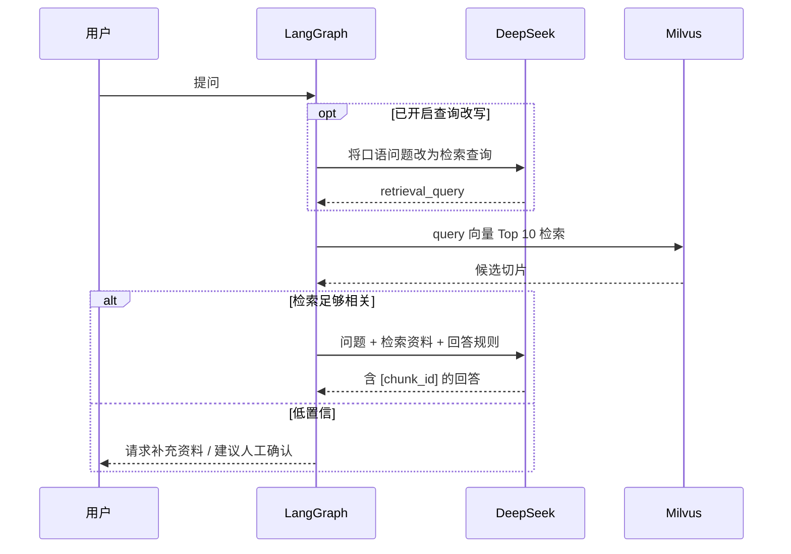

# RAG 童装客服助手：当前实现流程图

本文档对应当前的 `app.py` 和 Web 界面实现，描述的是已经运行的逻辑，而非未来规划。

## 1. 系统总览



## 2. 建立知识库流程

界面左侧“知识库构建”触发 `POST /api/ingest`。



每个 chunk 除向量外，还会保存：

- `chunk_id`：由文档 hash、切片策略、序号生成；
- `source_file`、`source_hash`、`document_id`；
- `heading_path`：如“售前话术 / 尺码推荐”；
- `chunk_index`、`text`、`strategy`。

## 3. 问答流程

界面中部“检索并回答”触发 `POST /api/ask`。



## 4. LangGraph 节点与 Trace 对照

| Trace 节点 | 当前行为 | Trace 中能看到什么 |
| --- | --- | --- |
| `query_rewrite` | 若界面勾选“使用查询改写”，调用 DeepSeek；未勾选则直接使用原问题 | 原始问题、改写后问题、耗时 |
| `retrieve` | 将检索问题向量化，在 Milvus 召回 Top 10 | 候选 chunk ID、相似度、标题路径、耗时 |
| `generate` | 使用最终保留的前 `top_k` 个切片生成回答 | 上下文切片数、耗时 |
| `groundedness_check` | 从答案中提取 `[chunk_id]`，检查是否属于本次检索结果 | 是否通过、引用的 chunk ID |
| `complete` | 汇总本次请求 | `trace_id` 与总耗时 |

> `clarify` 是安全分支，目前不单独写入 Trace 节点；当检索为空或最高分低于 `MIN_RETRIEVAL_SCORE`（默认 `0.25`）时，响应里的 `warning` 会标为“低置信检索：已安全拒答”。

## 5. 两次 LLM 调用



### 查询改写提示词

```text
把用户童装咨询改写成适合知识库检索的一行关键词。
不可回答问题、不可增加不存在的商品事实，只输出改写结果。
```

### 回答生成提示词的核心约束

```text
只可依据给出的资料回答；
资料未说明时明确说不知道或建议人工确认；
不可捏造库存、价格、成分、标准和售后政策；
末尾必须用“来源：[chunk_id]”列出支撑答案的编号。
```

## 6. 页面与后端映射

| 页面区域 | 后端接口 / 数据 |
| --- | --- |
| 知识库构建 | `POST /api/ingest`，展示切片数量、耗时、预览 |
| 顶部状态 | `GET /api/status`，展示 collection 中的切片数和源文件 |
| 调试问答 | `POST /api/ask`，展示最终回答和引用卡片 |
| 运行 Trace | `/api/ask` 响应的 `trace` 数组 |

## 7. 当前边界

- 当前是 dense 向量检索，尚未启用 sparse / 混合检索和 reranker。
- 回答引用校验只验证“引用 ID 是否来自本次检索”，不判断每一句话是否逐字被资料支持。
- 知识库重建会删除当前 `rag_chunks_v1` collection 后重新写入。
- 未接入真实 SKU、库存、订单或物流系统；相关问题应安全拒答或建议人工确认。
